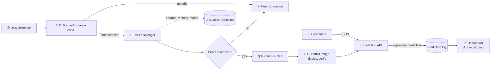

<div align="center">

# 🔮 Real-Time AI Prediction Platform
### with an Automated MLOps Pipeline

**A machine learning system that predicts customer churn in real time, notices when the world changes,<br>retrains itself, and ships the better model to production with no human in the loop.**

[](https://github.com/NavodiSenevirathne/AI_prediction_platform/actions/workflows/ci.yml)
[](https://github.com/NavodiSenevirathne/AI_prediction_platform/actions/workflows/cd.yml)
[](https://github.com/NavodiSenevirathne/AI_prediction_platform/actions/workflows/retrain.yml)


### [🚀 Live API](https://churn-prediction-api-uw5o.onrender.com/docs) · [📈 Live Dashboard](https://churn-monitoring-dashboard.onrender.com) · [🧪 Experiments](https://dagshub.com/NavodiSenevirathne/AI_prediction_platform/experiments) · [🧾 Model History](https://churn-prediction-api-uw5o.onrender.com/model/info)

</div>

> ⏳ **Heads-up:** the live services run on Render's free tier and sleep after 15 minutes idle. The first request can take about a minute to wake them up.

---

## 📌 Table of contents

- [At a glance](#-at-a-glance)
- [The problem](#-the-problem)
- [Architecture](#-architecture)
- [The self-updating loop](#-the-self-updating-loop)
- [Model performance](#-model-performance)
- [Proof it works: v1 → v2](#-proof-it-works-v1--v2)
- [Tech stack](#-tech-stack)
- [Data drift monitoring](#-data-drift-monitoring)
- [API](#-api)
- [CI/CD workflows](#-cicd-workflows)
- [Run it locally](#-run-it-locally)
- [Repository structure](#-repository-structure)
- [Limitations & future work](#-limitations--future-work)
- [Author](#-author)

---

## ✨ At a glance

| | |
|:---|:---|
| ⚡ **Prediction speed** | ~10 ms per request (local load test: avg 9.7 ms, P95 17.7 ms) |
| 🎯 **Model quality** | ROC-AUC **0.864** (v1) → **0.867** (v2, on drifted data) |
| 🔁 **Retraining** | Daily at 06:00 (Sri Lanka time) + on demand |
| 🛡️ **Safety gate** | New model ships **only if it beats** the current one |
| 🚀 **Drift → live new model** | **4 min 40 s**, fully automated |
| ✅ **Automated tests** | 17 (unit + integration) on every push |
| 🐳 **Containers** | 2 Docker images, versioned per model (`api:model-vN`) |

---

## 💡 The problem

A telecom company wants to know, **the moment a customer interacts with any channel**, how likely that customer is to **churn** (cancel), so retention offers can be targeted in real time.

But customers change: new pricing, more fibre users, heavier data usage. **A model trained once slowly goes stale.**

This platform watches for that change, and when it happens, it **retrains, tests, and redeploys a better model by itself.**

---

## 🧱 Architecture


| Layer | What lives there |
|:---|:---|
| **1 · Serving** (Render) | FastAPI prediction API · Streamlit monitoring dashboard · prediction log |
| **2 · Automation** (GitHub Actions) | CI workflow · CD workflow · automated retraining workflow |
| **3 · Storage & tracking** | GitHub repo (code + production model) · GHCR (images) · MLflow on DagsHub (experiments + registry) |

---

## 🔁 The self-updating loop



1. **Customers** hit the API, and every prediction is logged.
2. The **dashboard** compares live traffic with the model's training data.
3. Every day the **retraining pipeline** runs: ingest → validate → drift check → train challenger → compare.
4. The challenger is promoted **only if it outperforms** the champion on the same fresh data.
5. **CD** builds a new Docker image, deploys it to Render, and waits until the live API reports the new version.

> 👉 **Try it yourself:** go to **Actions → Automated retraining → Run workflow** and set drift to `0.8`.

---

## 🎯 Model performance

**Algorithm:** `HistGradientBoostingClassifier` inside a scikit-learn pipeline (`StandardScaler` + `OneHotEncoder`), so training and serving use exactly the same preprocessing.

| Metric | v1 · initial model | v2 · after automated retraining |
|:---|:---:|:---:|
| **ROC-AUC** | **0.864** | **0.867** |
| Accuracy | 0.804 | 0.819 |
| Precision | 0.711 | 0.854 |
| Recall | 0.641 | 0.903 |
| F1 score | 0.674 | 0.878 |
| Log loss | 0.421 | 0.397 |
| Evaluated on | 4,000 customers (original market) | 2,400 customers (drifted market) |
| Churn rate in that data | 32% | 72% |

> ℹ️ v1 and v2 are scored on different data, and the drifted market has far more churners (72% vs 32%). That is why precision, recall and F1 jump. The fair, like-for-like comparison is the one the pipeline makes below.

---

## 🧪 Proof it works: v1 → v2

On **13 Oct 2026** the platform received drifted data and upgraded itself:

| Step | Result |
|:---|:---|
| 📥 New data | 8,000 customers from a shifted market |
| 🔎 Drift check | **3 of 9 features drifted** (33%, above the 30% threshold) |
| 🥊 Champion v1 on new data | ROC-AUC **0.8538** |
| 🧠 Challenger on the **same** data | ROC-AUC **0.8669** ✅ better |
| 📦 Decision | **Promoted to v2** |
| 🚀 Deployment | Image built, deployed to Render, v2 verified live |
| ⏱️ Total time | **4 min 40 s**, zero manual steps |

**Features that drifted:**

| Feature | PSI | Status |
|:---|:---:|:---:|
| `num_support_calls` | 1.11 | 🔴 drifted |
| `monthly_charges` | 1.01 | 🔴 drifted |
| `avg_daily_usage_gb` | 0.60 | 🔴 drifted |
| `contract_type` | 0.19 | 🟡 moderate |
| `age` | 0.15 | 🟡 moderate |
| `tenure_months` | 0.14 | 🟡 moderate |
| `internet_service` | 0.09 | 🟢 stable |
| `payment_method` | 0.03 | 🟢 stable |
| `total_charges` | 0.01 | 🟢 stable |

---

## 🧰 Tech stack

| Category | Technology | Used for |
|:---|:---|:---|
| 🐍 Language | **Python 3.12** | Everything |
| 🧠 Machine learning | **scikit-learn 1.9** · pandas · NumPy | Pipeline, HistGradientBoosting model, evaluation |
| 📐 Statistics | **SciPy** | KS and chi-squared drift tests |
| ⚡ Serving | **FastAPI** · Uvicorn · Pydantic | Real-time REST API with input validation |
| 📈 Monitoring | **Streamlit** · SQLite · Prometheus format | Dashboard, prediction log, `/metrics` |
| 🧪 Experiment tracking | **MLflow 3** on **DagsHub** | Runs, metrics, artifacts, Model Registry |
| 🐳 Containers | **Docker** · Docker Compose | API and dashboard images, local stack |
| 📦 Registry | **GitHub Container Registry** | Versioned images (`latest`, `sha`, `model-vN`) |
| ⚙️ CI/CD & orchestration | **GitHub Actions** | CI, CD, scheduled retraining |
| ☁️ Cloud | **Render** | Hosting both services |
| ✅ Quality | **pytest** · **ruff** | 17 tests, linting |

---

## 📊 Data drift monitoring

Each feature is compared with the model's training data using the **Population Stability Index (PSI)**:

| PSI | Meaning |
|:---:|:---|
| 🟢 < 0.1 | Stable |
| 🟡 0.1 – 0.2 | Moderate change |
| 🔴 ≥ 0.2 | **Significant drift**: feature flagged |

If **≥ 30% of features** are flagged, the dataset is drifted and retraining is triggered. KS (numeric) and χ² (categorical) tests are reported alongside PSI.

**Retraining triggers:** data drift · ROC-AUC below 0.80 · AUC drop above 0.03 · manual force

---

## 🔌 API

**Base URL:** `https://churn-prediction-api-uw5o.onrender.com` · [Interactive docs](https://churn-prediction-api-uw5o.onrender.com/docs)

| Method | Endpoint | Purpose |
|:---:|:---|:---|
| `POST` | `/predict` | Score one customer |
| `POST` | `/predict/batch` | Score up to 1,000 customers |
| `GET` | `/health` | Liveness + model version |
| `GET` | `/model/info` | Model metadata, metrics, version history |
| `POST` | `/model/reload` | Hot-reload the model (needs `X-Admin-Token`) |
| `GET` | `/monitoring/summary` | Traffic, latency, prediction distribution |
| `GET` | `/monitoring/drift` | Live drift report on the last N predictions |
| `GET` | `/monitoring/recent` | Latest logged predictions |
| `GET` | `/metrics` | Prometheus metrics |

<details>
<summary><b>📨 Example request & response</b></summary>

```bash
curl -X POST https://churn-prediction-api-uw5o.onrender.com/predict \
  -H "Content-Type: application/json" \
  -d '{"age": 34, "tenure_months": 5, "monthly_charges": 89.5, "total_charges": 447.5,
       "num_support_calls": 4, "avg_daily_usage_gb": 6.2, "contract_type": "month_to_month",
       "internet_service": "fiber", "payment_method": "electronic_check"}'
```

```json
{
  "prediction_id": "774a42f9bd16426ca0b29a2561ef8ea1",
  "churn_probability": 0.9021,
  "churn_prediction": true,
  "risk_level": "high",
  "model_version": 1
}
```

Risk levels: 🟢 **low** < 0.4 · 🟡 **medium** 0.4–0.7 · 🔴 **high** ≥ 0.7

</details>

---

## 🔄 CI/CD workflows

| Workflow | Runs when | What it does |
|:---|:---|:---|
| 🧪 **CI** | Every push & PR | Lint → 17 tests → model quality gate (AUC ≥ 0.75) → build images → container smoke test |
| 🚀 **CD** | Push to `main`, or after retraining | Tests → push images to GHCR → Render deploy hook → wait until new version is live → smoke test |
| 🔁 **Automated retraining** | Daily 06:00 (Sri Lanka) + manual | Drift check → retrain → compare → promote → commit → trigger CD |

---

## 💻 Run it locally

```bash
# 1. Set up
python -m venv .venv
.venv\Scripts\Activate.ps1          # Windows   (macOS/Linux: source .venv/bin/activate)
pip install -r requirements.txt

# 2. Test
pytest                              # ✅ 17 passed

# 3. Start the API
uvicorn src.api.main:app --reload   # → http://localhost:8000/docs
```

In a second terminal:

```bash
python scripts/simulate_traffic.py --n 300               # normal traffic
python scripts/simulate_traffic.py --n 300 --drift 0.9   # drifted traffic
streamlit run dashboard/app.py                           # → http://localhost:8501
```

Retraining & experiment tracking:

```bash
python -m src.pipelines.retrain --drift 0.8
mlflow ui --backend-store-uri sqlite:///mlflow.db --workers 1   # → http://localhost:5000
```

🐳 Or run everything with Docker:

```bash
docker compose up --build    # API :8000 · dashboard :8501 · MLflow :5000
```

---

## 📁 Repository structure

```
├── src/
│   ├── config.py                 # features, paths, drift/retraining thresholds
│   ├── data/generate.py          # customer data source with controllable drift
│   ├── training/
│   │   ├── model.py              # sklearn pipeline, evaluation, production model registry
│   │   ├── tracking.py           # MLflow integration (safe fallback when offline)
│   │   └── train.py              # initial (bootstrap) training
│   ├── monitoring/drift.py       # PSI, KS and chi-squared drift detection
│   ├── pipelines/retrain.py      # automated champion/challenger retraining
│   └── api/                      # FastAPI app, schemas, prediction log
├── dashboard/app.py              # Streamlit monitoring dashboard
├── scripts/simulate_traffic.py   # streams simulated real-time traffic
├── models/                       # current production model + metadata + reference data
├── reports/                      # retraining reports
├── tests/                        # 17 unit + integration tests
├── .github/workflows/            # ci.yml · cd.yml · retrain.yml
├── Dockerfile                    # API image
├── Dockerfile.dashboard          # dashboard image
├── docker-compose.yml            # full local stack
└── docs/                         # architecture diagram & technical documentation
```

---

## 🚧 Limitations & future work

| Today | Next step |
|:---|:---|
| Data source is **simulated** (with controllable drift) to demonstrate retraining | Connect a real labelled feed, or add a `/feedback` endpoint for true outcomes |
| Free-tier hosting sleeps when idle | Paid instance or keep-alive ping |
| Prediction log resets on redeploy | Managed PostgreSQL / data warehouse |
| No alerts | Slack / email alerts on drift and promotions |
| — | Grafana on `/metrics`, canary deployments, Optuna tuning |

---

## 👩‍💻 Author

<div align="center">

**Navodi Senevirathne**<br>
BI Developer Intern · Individual project · 2–16 October 2026

⭐ If you found this project interesting, consider giving it a star!

</div>
